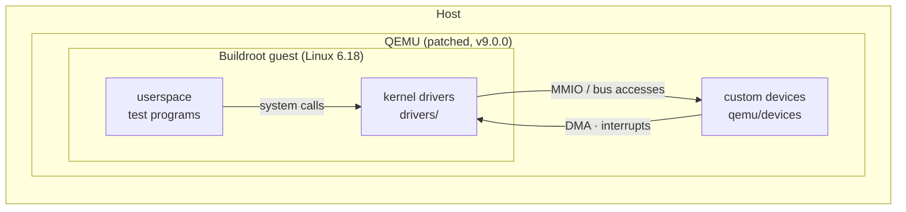

# Custom PCI Device Emulation & Linux Driver

This project demonstrates how hardware and operating systems interact with each other:
custom devices are emulated in QEMU and driven by Linux kernel drivers
running in a small Buildroot guest system. Everything is built from source
with pinned versions, so the whole setup is reproducible with a few commands.



## Projects

Each project is a QEMU device together with its Linux driver. The register
map of a device is the contract between both sides and is documented with it.

| Project | Device | Driver | Topics |
|---------|--------|--------|--------|
| [pci-dma](docs/pci-dma.md) | `custom-pci-device` | `drv_pci` | PCI, MMIO, DMA, MSI, misc device, ioctl, mmap, sysfs |

## Repository layout

```text
custom-pci-qemu/
├── qemu/
│   ├── devices/            # QEMU device models (+ meson.build, Kconfig)
│   └── patches/            # one-time patch: hooks qemu/devices into QEMU as hw/custom
├── include/                # headers shared by devices, drivers and userspace (register maps, UAPI)
├── drivers/
│   └── pci-dma/            # Linux driver for custom-pci-device
├── userspace/              # userspace programs for the drivers
├── buildroot-external/     # Buildroot external tree: guest config + driver packages
├── scripts/                # setup, build and run scripts
├── tests/guest/            # driver tests, run inside the guest by scripts/test.sh
├── docs/                   # one page per project (device + driver)
└── third_party/            # (not in git) QEMU, Buildroot, build outputs
```

QEMU and Buildroot are not part of this repository. The setup scripts clone
pinned versions into `third_party/`, apply the patch and build them.

## Quick start

Tested on Ubuntu 20.04 (x86_64). Needs about 15 GB of disk space.

```bash
git clone https://github.com/valentinfreund/custom-pci-qemu.git
cd custom-pci-qemu

./scripts/install-deps.sh       # host packages (apt, needs sudo)
./scripts/setup-qemu.sh         # clone, patch and build QEMU        (~10 min)
./scripts/setup-buildroot.sh    # build toolchain, kernel, rootfs    (~30-60 min, first time only)
./scripts/run.sh                # boot the guest in this terminal
```

Log in as `root` (no password). Each project page shows how to try its driver.
Leave QEMU with `Ctrl-a x`.

## Development workflow

| Task | Command |
|------|---------|
| Rebuild QEMU after changing a device | `./scripts/build.sh qemu` |
| Rebuild a driver and repack the guest image | `./scripts/build.sh drv-pci` |
| Rebuild everything that changed | `./scripts/build.sh` |
| Change the guest kernel configuration | `./scripts/build.sh linux-menuconfig` |
| Boot the guest | `./scripts/run.sh` |
| Run the driver tests (boots the guest) | `./scripts/test.sh` |
| Share `./share` with the guest at `/mnt/host` | `./scripts/run.sh --share` |
| Keep changes made inside the guest | `./scripts/run.sh --persist` |
| Pass extra options to QEMU | `./scripts/run.sh -- -d guest_errors` |

By default the guest disk is used in snapshot mode: every boot starts from the
freshly built image.

### Adding a new QEMU device

1. Put the source file into `qemu/devices/`.
2. Add a `config` entry to `qemu/devices/Kconfig` and a line to
   `qemu/devices/meson.build`.
3. Run `./scripts/build.sh qemu`.

No changes to the QEMU tree are necessary: `qemu/devices/` is symlinked into
QEMU as `hw/custom`.

### Adding a new driver

1. Put the driver into `drivers/<name>/` with a Kbuild `Makefile`.
2. Create `buildroot-external/package/<name>/` with `Config.in` and `<name>.mk`
   (copy `drv-pci` as a template) and source it from `buildroot-external/Config.in`.
3. Enable it in `buildroot-external/configs/driverlab_x86_64_defconfig`.

Add guest tests as `tests/guest/<name>.test`. Document the new device and driver in `docs/<name>.md` and add a row to the
[project table](#projects).

## License

GPL-2.0, see [LICENSE](LICENSE).
