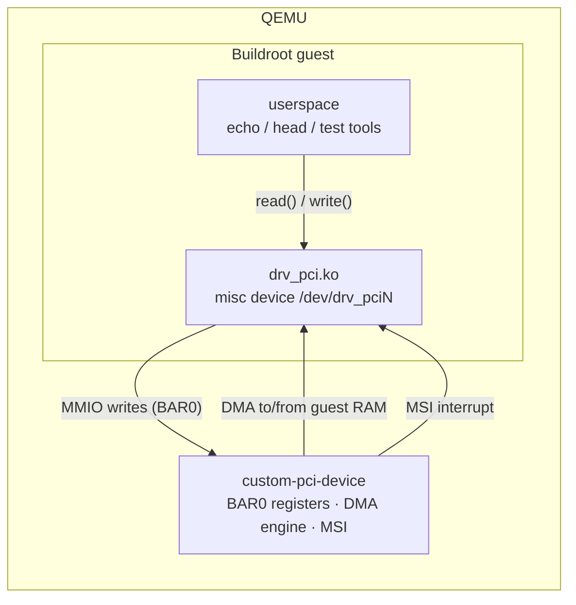

# pci-dma: PCI device with DMA and MSI

A PCI device with an MMIO register block (BAR0), DMA into guest memory and
MSI interrupts. Its Linux driver exposes the device to userspace as
`/dev/drv_pci0`, `/dev/drv_pci1`, … (one node per device).

| Part | Source |
|------|--------|
| QEMU device model | [`qemu/devices/custom-pci-device.c`](../qemu/devices/custom-pci-device.c) |
| Linux driver | [`drivers/pci-dma/drv_pci.c`](../drivers/pci-dma/drv_pci.c) |
| Buildroot package | [`buildroot-external/package/drv-pci/`](../buildroot-external/package/drv-pci/) |



## Device

| Property | Value |
|----------|-------|
| QEMU device name | `custom-pci-device` |
| Vendor / Device ID | `0x1234` / `0x5678` |
| BAR0 | 4 KiB memory-mapped registers |
| Interrupts | 1 MSI vector |

### BAR0 register map

| Offset | Name | Access | Description |
|--------|------|--------|-------------|
| `0x00` | `IRQ_TRIGGER` | W | Writing `1` raises an MSI interrupt |
| `0x04` | `DMA_ADDR_LOW` | W | DMA bus address, bits 31:0 |
| `0x08` | `DMA_ADDR_HIGH` | W | DMA bus address, bits 63:32 |
| `0x0C` | `DMA_SIZE` | W | Transfer size in bytes |
| `0x10` | `DMA_CMD` | W | `1`: device reads from guest memory, `2`: device writes to guest memory. Raises an MSI when done. |

## Driver

The driver `drv_pci` maps BAR0, allocates a 4 KiB coherent DMA buffer and
registers one MSI vector. For every device it creates a misc device
`/dev/drv_pci<N>`:

- `write()` copies the user data into the DMA buffer and lets the device read
  it (`DMA_CMD = 1`).
- `read()` lets the device write into the DMA buffer (`DMA_CMD = 2`) and copies
  the result to userspace.

Both calls wait for the MSI interrupt that signals the end of the transfer.

## Try it

Boot the guest with `./scripts/run.sh`, log in as `root` and run:

```bash
lspci -nn | grep 1234:5678                # the device is on the bus
modprobe drv_pci                          # load the driver
echo "Hello DMA" > /dev/drv_pci0          # device reads the buffer via DMA
head -c 16 /dev/drv_pci0 | hexdump -C     # device writes a pattern via DMA
dmesg | tail                              # probe, DMA and interrupt messages
```
