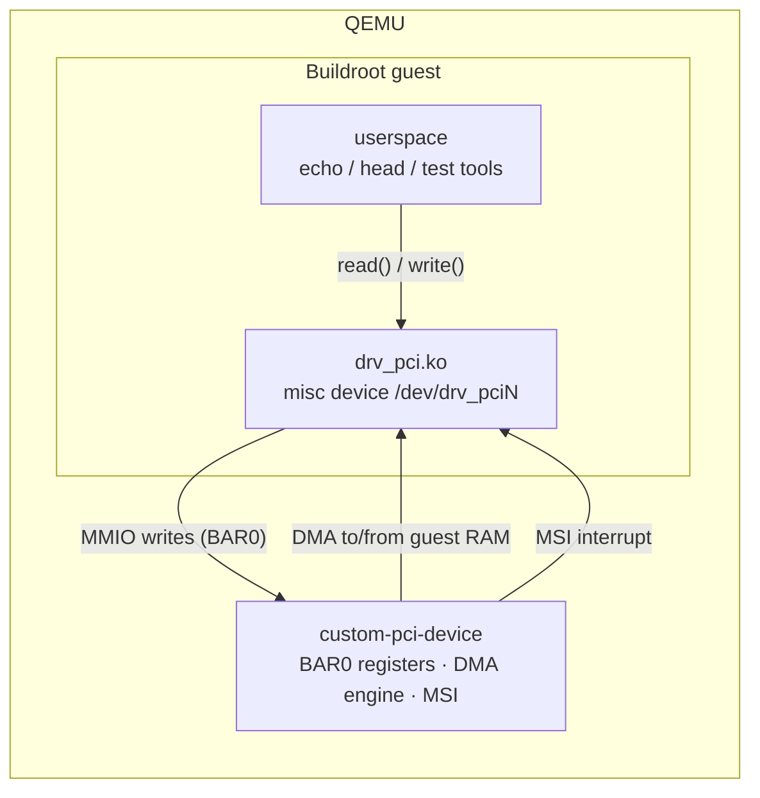

# pci-dma: PCI device with DMA and MSI

A PCI device with an MMIO register block (BAR0), DMA into guest memory and
MSI interrupts. Its Linux driver exposes the device to userspace as
`/dev/drv_pci0`, `/dev/drv_pci1`, … (one node per device).

| Part | Source |
|------|--------|
| QEMU device model | [`qemu/devices/custom-pci-device.c`](../qemu/devices/custom-pci-device.c) |
| Linux driver | [`drivers/pci-dma/drv_pci.c`](../drivers/pci-dma/drv_pci.c) |
| Buildroot package | [`buildroot-external/package/drv-pci/`](../buildroot-external/package/drv-pci/) |



## Device

| Property | Value |
|----------|-------|
| QEMU device name | `custom-pci-device` |
| Vendor / Device ID | `0x1234` / `0x5678` |
| BAR0 | 4 KiB memory-mapped registers (32-bit accesses) |
| Device memory | 4 KiB, reachable only through DMA |
| Interrupts | 1 MSI vector |

The device has its own 4 KiB memory. A DMA command copies `DMA_SIZE` bytes
between guest memory at `DMA_ADDR` and device memory at `DEV_ADDR`, then
raises an MSI. Transfers that do not fit into the device memory are rejected
with `STATUS.ERROR`; the interrupt is raised anyway, so the driver never waits
forever.

### BAR0 register map

| Offset | Name | Access | Description |
|--------|------|--------|-------------|
| `0x00` | `IRQ_TRIGGER` | W | Writing `1` raises an MSI interrupt |
| `0x04` | `DMA_ADDR_LOW` | R/W | DMA bus address in guest memory, bits 31:0 |
| `0x08` | `DMA_ADDR_HIGH` | R/W | DMA bus address in guest memory, bits 63:32 |
| `0x0C` | `DMA_SIZE` | R/W | Transfer size in bytes (1 to 4096) |
| `0x10` | `DMA_CMD` | W | Starts a transfer. `1`: guest memory → device memory, `2`: device memory → guest memory. Raises an MSI when done. |
| `0x14` | `DEV_ADDR` | R/W | Offset in device memory |
| `0x18` | `STATUS` | R | Bit 0 `ERROR`: the last DMA command was rejected |

## Driver

The driver `drv_pci` maps BAR0, allocates a 4 KiB coherent DMA buffer and
registers one MSI vector. For every device it creates a misc device
`/dev/drv_pci<N>` whose file position maps 1:1 to the device memory:

- `write()` copies the user data into the DMA buffer and lets the device read
  it into its memory (`DMA_CMD = 1`).
- `read()` lets the device write its memory into the DMA buffer
  (`DMA_CMD = 2`) and copies the result to userspace.

Each call is one DMA transfer and waits for the completion interrupt (at most
1 s). A mutex serializes transfers per device. `STATUS.ERROR` is reported as
`-EIO`.

## Try it

Boot the guest with `./scripts/run.sh`, log in as `root` and run:

```bash
lspci -nn | grep 1234:5678                    # the device is on the bus
modprobe drv_pci                              # load the driver
echo "Hello DMA" > /dev/drv_pci0              # copy into device memory via DMA
head -c 16 /dev/drv_pci0 | hexdump -C         # and read it back via DMA
grep drv_pci /proc/interrupts                 # one MSI per transfer
echo 'module drv_pci +p' > /proc/dynamic_debug/control   # log every transfer
dmesg | tail
```

## Tests

`./scripts/test.sh` starts QEMU with two devices and runs
[`tests/guest/pci-dma.test`](../tests/guest/pci-dma.test): binding to both
devices, DMA loopback (whole buffer, small and chunked transfers), one MSI per
transfer and a clean module unload.
