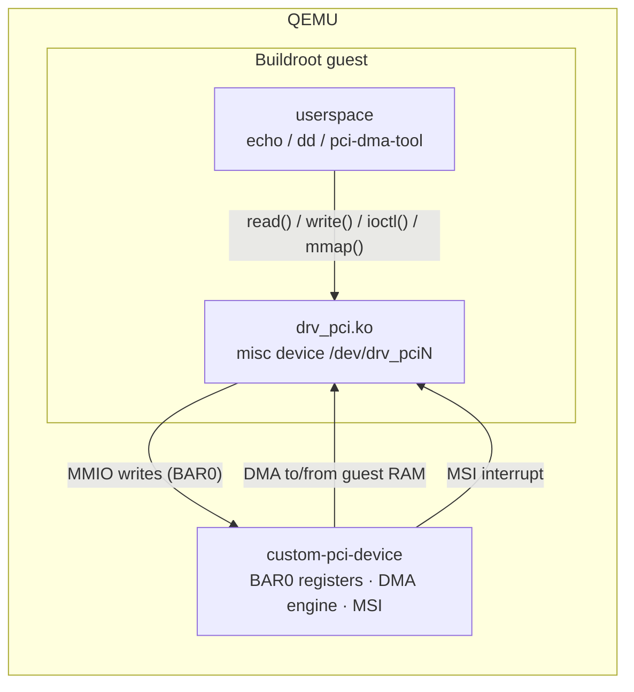

# pci-dma: PCI device with DMA and MSI

A PCI device with an MMIO register block (BAR0), DMA into guest memory and
MSI interrupts. Its Linux driver exposes the device to userspace as
`/dev/drv_pci0`, `/dev/drv_pci1`, … (one node per device).

| Part | Source |
|------|--------|
| QEMU device model | [`qemu/devices/custom-pci-device.c`](../qemu/devices/custom-pci-device.c) |
| Linux driver | [`drivers/pci-dma/drv_pci.c`](../drivers/pci-dma/drv_pci.c) |
| Userspace API | [`include/uapi/linux/drv_pci.h`](../include/uapi/linux/drv_pci.h) |
| Register map | [`include/driverlab/custom-pci-regs.h`](../include/driverlab/custom-pci-regs.h) |
| Userspace tool | [`userspace/pci-dma-tool/`](../userspace/pci-dma-tool/) |
| Buildroot packages | [`drv-pci`](../buildroot-external/package/drv-pci/), [`pci-dma-tool`](../buildroot-external/package/pci-dma-tool/) |



## Device

| Property | Value |
|----------|-------|
| QEMU device name | `custom-pci-device` |
| Vendor / Device ID | `0x1234` / `0x5678` |
| BAR0 | 4 KiB memory-mapped registers (32-bit accesses) |
| Device memory | 4 KiB, reachable only through DMA |
| Interrupts | 1 MSI vector |

The device has its own 4 KiB memory. A DMA command copies `DMA_SIZE` bytes
between guest memory at `DMA_ADDR` and device memory at `DEV_ADDR`, then
raises an MSI. Transfers that do not fit into the device memory are rejected
with `STATUS.ERROR`; the interrupt is raised anyway, so the driver never waits
forever.

### BAR0 register map

| Offset | Name | Access | Description |
|--------|------|--------|-------------|
| `0x00` | `IRQ_TRIGGER` | W | Writing `1` raises an MSI interrupt |
| `0x04` | `DMA_ADDR_LOW` | R/W | DMA bus address in guest memory, bits 31:0 |
| `0x08` | `DMA_ADDR_HIGH` | R/W | DMA bus address in guest memory, bits 63:32 |
| `0x0C` | `DMA_SIZE` | R/W | Transfer size in bytes (1 to 4096) |
| `0x10` | `DMA_CMD` | W | Starts a transfer. `1`: guest memory → device memory, `2`: device memory → guest memory. Raises an MSI when done. |
| `0x14` | `DEV_ADDR` | R/W | Offset in device memory |
| `0x18` | `STATUS` | R | Bit 0 `ERROR`: the last DMA command was rejected |

## Driver

The driver `drv_pci` maps BAR0, allocates a 4 KiB coherent DMA buffer and
registers one MSI vector. For every device it creates a misc device
`/dev/drv_pci<N>` with three interfaces:

| Interface | Purpose |
|-----------|---------|
| `read()` / `write()` | Simple byte stream, usable with `echo`, `cat`, `dd`. The file position maps 1:1 to the device memory. |
| `ioctl()` + `mmap()` | Zero-copy: the process maps the DMA buffer and starts transfers with explicit offsets and direction. |
| sysfs | Status and statistics, one value per file. |

Every transfer waits for the completion interrupt (at most 1 s). A mutex
serializes transfers per device. `STATUS.ERROR` is reported as `-EIO`.

### read() / write()

- `write()` copies the user data into the DMA buffer and lets the device read
  it into its memory (`DMA_CMD = 1`).
- `read()` lets the device write its memory into the DMA buffer
  (`DMA_CMD = 2`) and copies the result to userspace.

### ioctl() and mmap()

The userspace API is defined in
[`include/uapi/linux/drv_pci.h`](../include/uapi/linux/drv_pci.h):

| ioctl | Argument | Description |
|-------|----------|-------------|
| `DRV_PCI_IOC_INFO` | `struct drv_pci_info` (out) | Buffer size, device memory size, instance number |
| `DRV_PCI_IOC_DMA` | `struct drv_pci_dma` (in) | One transfer: `direction` (`DRV_PCI_DMA_TO_DEVICE` / `_FROM_DEVICE`), `size`, `buf_offset`, `dev_offset`. `flags` and `reserved` must be 0. |

`mmap()` maps the whole DMA buffer (offset 0, up to `buf_size` bytes). A
typical zero-copy sequence:

```c
struct drv_pci_info info;
ioctl(fd, DRV_PCI_IOC_INFO, &info);
unsigned char *buf = mmap(NULL, info.buf_size, PROT_READ | PROT_WRITE, MAP_SHARED, fd, 0);

memcpy(buf, data, n);                               /* fill the DMA buffer directly */
struct drv_pci_dma req = { .direction = DRV_PCI_DMA_TO_DEVICE, .size = n };
ioctl(fd, DRV_PCI_IOC_DMA, &req);                   /* device reads it */
```

Limitations: all processes that open a device share its DMA buffer, and
unbinding the device while the buffer is mapped is not handled.

### sysfs

Read-only files in `/sys/bus/pci/devices/<address>/`, also reachable as
`/sys/class/misc/drv_pci<N>/device/`:

| File | Content |
|------|---------|
| `instance` | `N` of `/dev/drv_pci<N>` |
| `status` | Current value of the `STATUS` register, e.g. `0x00000000` |
| `dma_transfers` | Completed DMA transfers |
| `dma_bytes` | Bytes moved by completed transfers |
| `dma_errors` | Transfers that failed (timeout or rejected by the device) |

## Try it

Boot the guest with `./scripts/run.sh`, log in as `root` and run:

```bash
lspci -nn | grep 1234:5678                    # the device is on the bus
modprobe drv_pci                              # load the driver
echo "Hello DMA" > /dev/drv_pci0              # copy into device memory via DMA
head -c 16 /dev/drv_pci0 | hexdump -C         # and read it back via DMA
pci-dma-tool info /dev/drv_pci0               # ioctl DRV_PCI_IOC_INFO
pci-dma-tool loopback /dev/drv_pci0           # zero-copy loopback with mmap + ioctl
cat /sys/class/misc/drv_pci0/device/dma_*     # statistics
grep drv_pci /proc/interrupts                 # one MSI per transfer
echo 'module drv_pci +p' > /proc/dynamic_debug/control   # log every transfer
dmesg | tail
```

## Performance

`pci-dma-tool bench /dev/drv_pci0 20000` compares both paths with 4 KiB
transfers (KVM guest, QEMU built with `--enable-debug`):

| Path | Throughput | Time per transfer |
|------|-----------:|------------------:|
| `read()` / `write()` | 119 MB/s | 34 µs |
| `mmap()` + `ioctl()` | 120 MB/s | 34 µs |

Zero-copy makes no measurable difference here. Copying 4 KiB takes well under
a microsecond; the time goes elsewhere: every register access (5 writes and
1 read per transfer) exits the VM into QEMU, and every transfer injects an
interrupt and wakes up the waiting process. Zero-copy pays off when copying
dominates: large buffers, or real hardware where a register access costs
nanoseconds. The remaining cost per transfer is what descriptor rings and
doorbells in real accelerators avoid.

## Tests

`./scripts/test.sh` starts QEMU with two devices and runs
[`tests/guest/pci-dma.test`](../tests/guest/pci-dma.test): binding to both
devices, DMA loopback (whole buffer, small and chunked transfers), one MSI per
transfer, ioctl and mmap (zero-copy loopback with different offsets, invalid
requests rejected), sysfs attributes and a clean module unload.
